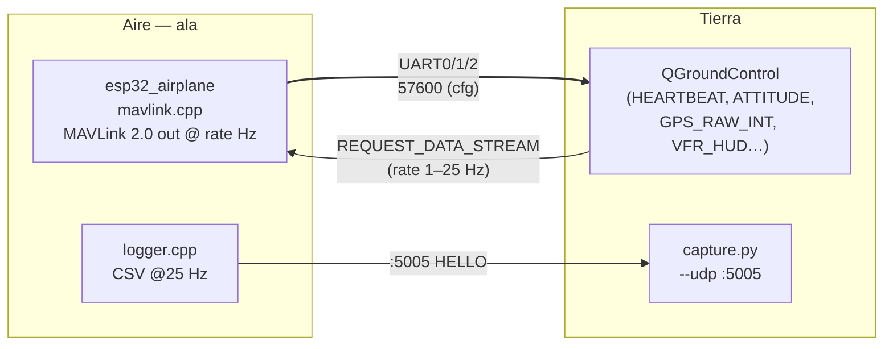
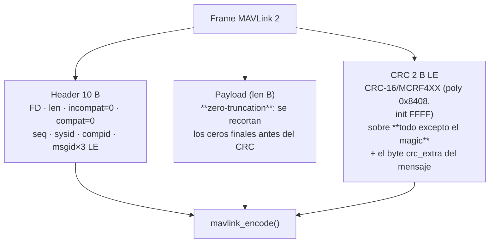
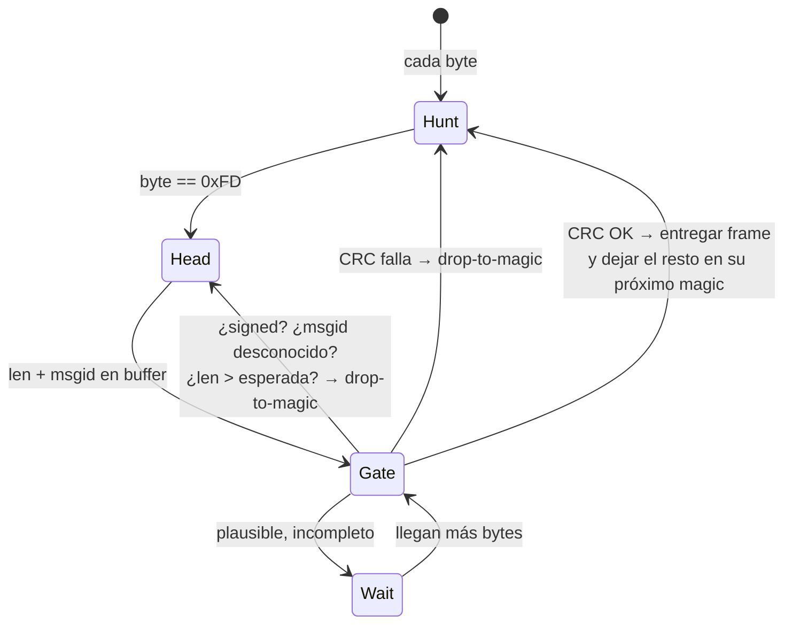
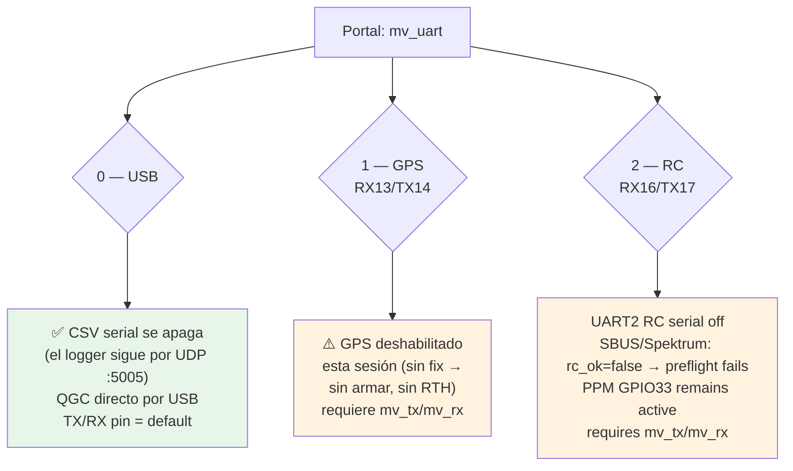

# MAVLink telemetry over a configurable UART — I1

> Goal: let a ground station (QGroundControl / Mission Planner / MAVProxy)
> watch the wing live — attitude, position, GPS, servo outputs, heartbeat —
> over **any of the three ESP32 UARTs**, enabled and configured from the WiFi
> portal.
>
> Companion: [`../CHECKLIST.md`](../CHECKLIST.md) §I.1 / §I.4 ·
> [`test-campaign.md`](test-campaign.md) §1 (logger sinks) ·
> [`rc-and-telemetry.md`](rc-and-telemetry.md) (telemetry to the **TX16S** —
> a different link, still tracked separately under I1)
>
> Implementation: `firmware/esp32_airplane/mavlink.{h,cpp}` (pure C++,
> host-tested) · tests: `firmware/tests/test_mavlink.cpp` (**53 assertions**).

---

## 1. Direct answer

| Question | Answer |
|----------|--------|
| ¿Qué hablamos? | **MAVLink 2.0** (magic `0xFD`), sin firma (signing), sin param protocol, sin comandos. Telemetría de salida + `REQUEST_DATA_STREAM` de entrada — lo mínimo para que QGC muestre el avión en vivo. |
| ¿Por qué una implementación propia? | Cero dependencias: el firmware no arrastra la librería MAVLink (millares de archivos generados). El encoder se **compara byte a byte** contra frames dorado de `pymavlink` en los tests → misma salida, ~300 líneas. |
| ¿Puerto configurable? | SÍ: UART0 (USB), UART1 (GPS) o UART2 (SBUS/Spektrum RC; PPM en GPIO33 queda independiente), baudios 9600–921600, rate rápido 1–25 Hz, sysid — todo en el portal (`mv_*`). |
| ¿El CSV serial sigue? | Solo si MAVLink **no** está en UART0. En UART0 el binario y el CSV no caben juntos en la misma línea → el CSV pasa a su sink UDP (`:5005`) y QGC se lleva el USB. |
| ¿Telemetría al TX16S? | **No esto** — eso es S.Port/FPort por el enlace RC ([`rc-and-telemetry.md`](rc-and-telemetry.md)). Este doc es el enlace GCS (laptop/tablet). |



---

## 2. Frame rules we implement (v2)



Verified points (each pinned by a golden test):

| Rule | Golden |
|------|--------|
| CRC skips the `0xFD` magic, includes `crc_extra` | `HB_0` → `0xEB95` |
| CRC-16/MCRF4XX check value `'123456789' = 0x6F91` | `test_crc16` |
| Trailing zero bytes trimmed (`VFR_HUD` throttle=65 → 19 of 20 B) | `VFR_11` |
| Field order = size order (u32 first, u8 last): `battery_remaining` last in SYS_STATUS, `port` last in SERVO_OUTPUT_RAW | `SYS_9`, `SRV_13` |
| seq/sysid/compid feed both header and CRC | `HB_0` vs `HB_42` |
| STATUSTEXT: severity + text, `id`/`chunk_seq` (zeros) trimmed | `TXT_2` |

CRC extras are from the common dialect: HEARTBEAT 50, SYS_STATUS 124,
GPS_RAW_INT 24, ATTITUDE 39, GLOBAL_POSITION_INT 104, SERVO_OUTPUT_RAW 222,
VFR_HUD 20, STATUSTEXT 83, REQUEST_DATA_STREAM 148.

---

## 3. Messages we publish

| Msg | ID | Rate | Content |
|-----|----|------|---------|
| HEARTBEAT | 0 | 1 Hz | type=`FIXED_WING`, autopilot=`GENERIC`, base_mode armed bit, custom_mode = guidance phase, state STANDBY/ACTIVE |
| SYS_STATUS | 1 | 1 Hz | sensor present/enabled/health bitmask (gyro/accel/mag/baro/GPS/RC), battery fields 0/−1 (ADC pending B4) |
| GPS_RAW_INT | 24 | 1 Hz | fix type (0/3/4), lat/lon ×1e7, alt mm, eph=hdop×100, vel, cog, sats |
| ATTITUDE | 30 | `rate_hz` | t_ms, roll/pitch/yaw rad, body rates from the AHRS |
| GLOBAL_POSITION_INT | 33 | `rate_hz` | lat/lon, alt + relative_alt (home latch), vx/vy from GS+track (cm/s N/E), hdg |
| SERVO_OUTPUT_RAW | 36 | `rate_hz` | left/right elevon µs + throttle µs (what the PWMs are doing) |
| VFR_HUD | 74 | `rate_hz` | groundspeed, heading, throttle %, alt — airspeed=0 (no pitot, C5), climb=0 (baro diff comes with F6) |
| STATUSTEXT | 253 | on events | `"mavlink up"` at init (shows in the GCS console) |

Inbound: **REQUEST_DATA_STREAM (66)** only — sets the fast rate
(clamped 1…25 Hz = `LOG_RATE_HZ`), accepts broadcast targets `0/255` and our
sysid, ignores `start_stop=0` (we never stop streaming).

### RX resynchronisation



The **early gate** (msgid visible at byte 7–9) is what keeps a stray `0xFD`
in the noise from swallowing the whole next frame: an unrecognised or
length-inconsistent frame is abandoned *before* its payload finishes
arriving, the same drop-one-byte-and-hunt strategy as the SBUS decoder.

---

## 4. Which UART? (portal `mv_uart`)



Rules wired in `esp32_airplane.ino`:

- **UART0** (default): `Serial.begin(mv_baud)`; `log_emit()` and the CSV
  header print are suppressed (`mav_on_usb()`); UDP sink keeps running →
  `capture.py --udp 192.168.4.1:5005`.
- **UART1**: `gps_init()`/`gps_poll()` skipped → no fix (arming preflight
  blocks; RTH unavailable). Log lines in `setup()` say so.
- **UART2**: SBUS/Spektrum serial RC is skipped → `g_rc_ok=false` →
  preflight fails; if already armed the RC-loss failsafe path runs. PPM-SUM
  is captured independently on GPIO33 and remains active while UART2 carries
  MAVLink (select PPM in the portal; see `docs/wiring.md` §5.3).
- `mav_uart_init()` runs **last** (boot and every portal save) so its
  `begin()` owns the pins; re-init restores GPS/RC when MAVLink is switched
  off again.
- UART1/2 additionally need `mv_tx`/`mv_rx` GPIOs (-1..39): the ESP32 can map
  any UART to any pin, but picking them is the pilot's job — without them
  MAVLink stays off with a portal-visible warning.

> **⚠️ Don't flip `mv_uart` while armed.** Taking UART2 mid-flight loses
> SBUS/Spektrum RC; PPM on GPIO33 is independent. Taking UART1 means no GPS.

## 5. Portal fields

| Field | Key | Range | Default |
|-------|-----|-------|---------|
| Activar MAVLink | `mv_en` | 0/1 | 0 |
| Puerto | `mv_uart` | 0/1/2 | 0 (USB) |
| Baudios | `mv_baud` | 9600…921600 | 57600 |
| Rate rápido | `mv_rate` | 1…25 Hz | 10 |
| System ID | `mv_sys` | 1…255 | 1 |
| TX pin | `mv_tx` | -1…39 | -1 (default) |
| RX pin | `mv_rx` | -1…39 | -1 (default) |

Settings blob bumped **v6 → v7** (`MavlinkSettings`); every range is
clamped by `settings_validate()` (bad portal POSTs can never produce an
unstreamable link) and survives the NVS round trip (tested).

## 6. Connect recipe

```bash
# Terminal 1 (PC): start the CSV capture on UDP (works with MAVLink on UART0)
python3 tools/wing_logger/capture.py --udp 192.168.4.1:5005 -o run.csv
```

1. Portal (`http://wing-xxxx/` → *Telemetría MAVLink*): `mv_en=1`,
   `mv_uart=0`, `mv_baud=57600` → Save (the wing reboots its UART0).
2. QGroundControl → *Application Settings → Comm Links*:
   Serial, device = the ESP32 USB port, baud = the portal value.
   QGC sends `REQUEST_DATA_STREAM` on connect → the fast rate follows it
   (1–25 Hz; heartbeat/GPS/SYS stay at 1 Hz regardless).
3. Vehicle tab shows attitude, map track, GPS raw. Console shows
   `mavlink up`.

Sanity check without QGC: `python3 -m pymavlink ...` or any byte sniffer —
every frame starts `FD …` and QGC's *Link Inspector* shows the message rates.

## 7. Tests

```bash
cd esp32-airplane/firmware && make test        # 53 MAVLink assertions
cd tools/simulator && make check               # runs it too
```

`tests/test_mavlink.cpp` covers:

- **Golden frames** — 9 frames byte-compared against `pymavlink` output
  (HB×2, ATT, GPI, VFR incl. zero-trim, GPS, SYS, SRV, TXT) + the inbound
  RDS golden.
- **CRC** — MCRF4XX check value, running vs one-shot accumulator.
- **Encode guards** — undersized buffer → 0, all-zero payload trims to 12 B,
  null payload rules.
- **RX** — junk/stray-magic resync, flipped-byte CRC reject, signed-frame
  drop, unknown-msgid discard, truncated-frame recovery, GCS heartbeat.
- **Scheduler** — 7 messages, 1 Hz group vs fast group, rate clamps
  (0→1, 90→25), `set_rate` from RDS.
- **Settings** — `test_rc_settings.cpp` `[settings mavlink]`: defaults,
  every clamp, blob round trip.

## 8. Not implemented (by choice, v1)

| Feature | Why |
|---------|-----|
| Signing | bench/tethered link; incompat=0 (any signed frame is dropped) |
| PARAM protocol / SET_MODE / commands | no parameter tree yet — settings live in the portal |
| ACK / command handling | GCS displays work without it |
| Battery V/A | ADC pending (B4/H3) — SYS_STATUS carries 0/−1 |
| `vz`, airspeed, climb | vertical speed estimator comes with F6 baro-diff; pitot with C5 |
| Telemetry to the TX16S | different link (S.Port/FPort over the RC UART) — `rc-and-telemetry.md` |
