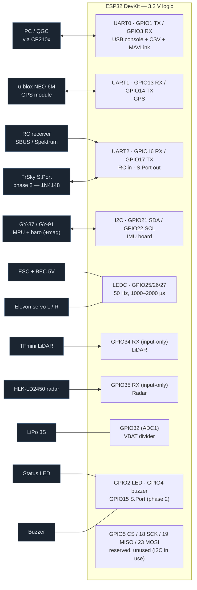
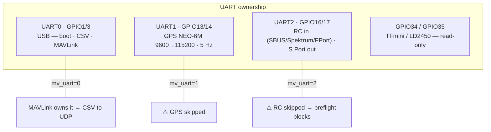

# Wiring — ESP32 ↔ every device (checklist B2)

> **Source of truth: `firmware/esp32_airplane/config.h`** (the pin-map block).
> This document *visualizes* it. If the two ever disagree, `config.h` wins —
> fix this file. Bench-verify everything with **props removed** (T0).

---

## 1. System overview



**One rule to rule them all: every ground is the same ground.**
Battery (−) → ESC → BEC 5 V powers the logic rail; servos/ESC/receiver take
5 V from the BEC; the ESP32 runs on 3.3 V logic. Never power a servo from the
ESP32's 3.3 V pin.

---

## 2. Physical pinout (typical DevKit)

Pins we use are marked `◄`; everything else stays free. **Check the
silkscreen of your board** — clones differ in order.

```
        ┌──────────────────────────────────────────┐
   EN   │  [ ] ESP32 DevKit            [ ] EN/RST  │
        │                                          │
 3V3    │  [ ] 3V3                         [ ] GND │
  GND   │  [ ] GND                         [ ] 23  │
        │  [ ] VP(36)                      [ ] 22  │
        │  [ ] VN(39)      UART0 ───►      [ ]  1 ◄│── CP210x RX  (USB)
  34 ◄  │  [ ] 34  ── LiDAR TX            [ ]  3 ◄│── CP210x TX  (USB)
  35 ◄  │  [ ] 35  ── radar TX            [ ] 21 ◄│── I2C SDA → IMU board
  32 ◄  │  [ ] 32  ── VBAT divider        [ ] GND │
        │  [ ] 33                         [ ] 19  │ (SPI MISO, reserved)
  25 ◄  │  [ ] 25  ── elevon L servo      [ ] 18  │ (SPI SCK,  reserved)
  26 ◄  │  [ ] 26  ── elevon R servo      [ ]  5  │ (SPI CS,   reserved)
  27 ◄  │  [ ] 27  ── ESC throttle        [ ] 17 ◄│── S.Port out (phase 2)
        │  [ ] 14 ◄│── GPS RX (ESP TX)     [ ] 16 ◄│── RC receiver SBUS/DATA
        │  [ ] 12                         [ ]  4 ◄│── buzzer
   GND  │  [ ] GND                        [ ]  0  │ (boot strap — leave free)
  13 ◄  │  [ ] 13 ◄│── GPS TX (ESP RX)     [ ]  2 ◄│── status LED (1 kΩ)
        │                                  [ ] 15 ◄│── S.Port half-duplex (p2)
        │            USB micro                USB   │
        └──────────────────────────────────────────┘

   VIN/5V pin ← BEC 5 V (in flight) — or power from USB on the bench
```

---

## 3. Pin table

| GPIO | Dir | Function | Device / notes |
|------|-----|----------|----------------|
| 1  | TX | UART0 → CP210x RX | USB console, CSV log, MAVLink (`mv_uart=0`). **Do not attach anything else.** |
| 3  | RX | UART0 ← CP210x TX | same |
| 13 | RX | UART1 ← GPS TX | u-blox NEO-6M NMEA/UBX @115200 after probe |
| 14 | TX | UART1 → GPS RX | UBX-CFG-PRT baud change (never left muted) |
| 16 | RX | UART2 ← receiver | SBUS (inverted) / Spektrum / FPort data |
| 17 | TX | UART2 → receiver | S.Port telemetry out (phase 2) |
| 15 | TX | S.Port half-duplex | tie to RX17 side via **1N4148** — `docs/rc-and-telemetry.md` §3 |
| 21 | I2C | SDA | IMU board (GY-87/GY-91), shared bus |
| 22 | I2C | SCL | IMU board |
| 25 | PWM | elevon L servo | LEDC, 50 Hz, 1000–2000 µs |
| 26 | PWM | elevon R servo | LEDC, 50 Hz |
| 27 | PWM | ESC throttle | LEDC, 50 Hz, arm at 1000 µs |
| 34 | RX | LiDAR data in | TFmini TX → GPIO34 (input-only, no pull-up) |
| 35 | RX | radar data in | LD2450 TX → GPIO35 (input-only) @256000 8N1 |
| 32 | ADC | battery sense | divider from LiPo (B4 — value TODO, calibrate) |
| 2  | out | status LED | keep series R ≥ 1 kΩ (strapping pin) |
| 4  | out | buzzer | optional |
| 5/18/19/23 | SPI | reserved | future SPI IMU — **unused today**, leave free |

---

## 4. Power distribution

```
LiPo 3S ──┬── ESC ──┬── motor (3 phases)
           │         └── BEC 5 V ──┬── ESP32 VIN (5V pin)
           │                       ├── servo + (L, R)
           │                       ├── receiver VCC
           │                       └── TFmini / LD2450 VCC (5 V parts)
           │
           └── VBAT sense ──[ Rtop ]──┬──[ Rbot ]── GND
                                      └── GPIO32 (ADC1) ≤ 3.3 V

GND rail: battery (−) ≡ ESC GND ≡ ESP32 GND ≡ receiver GND ≡ servo GND
```

- **Bench:** USB powers the DevKit — fine for all checks with props off.
- **Flight:** one source at a time — BEC 5 V on `VIN`, USB unplugged.
- The ESP32's 3.3 V pin can source only ~500 mA: sensors only, **never
  servos**.
- ADC on **ADC1** (GPIO32) on purpose — ADC2 is unusable while WiFi runs.

---

## 5. Per-bus details

### 5.1 I2C — the IMU board (C1/C2/C3)

| Wire | ESP32 | IMU board |
|------|-------|-----------|
| SDA | GPIO21 | SDA |
| SCL | GPIO22 | SCL |
| VCC | 3V3 | VCC (3.3 V) |
| GND | GND | GND |

One bus, three devices — addresses:

| Addr | Part | Board |
|------|------|-------|
| `0x68` | MPU6050 / MPU9250 | GY-87 / GY-91 |
| `0x77` | BMP180 | GY-87 |
| `0x76` | BMP280 | GY-91 |
| `0x1E` | HMC5883L | GY-87 *(see below)* |
| `0x0C` | AK8963 | GY-91 (inside MPU9250) |

**Diagnostic — the one line to read when a sensor is missing:**

```bash
# at boot:  [i2c] {"addrs":[0x68,0x77],"mpu":"68","hmc":null,...}
# or live:  curl http://192.168.4.1/api/i2c
```

> **Known hardware finding (2026-10):** the current GY-87 answers at
> `0x68`+`0x77` but **nobody at `0x1E` or `0x0D`** — no (working)
> magnetometer. The build therefore sets `-DCFG_USE_MAG=0`
> (`build_opt.h`): heading falls back to GPS course and preflight is not
> blocked. If a mag is fitted later, delete that flag.

### 5.2 UART1 — GPS (C4)

```
GPS module                 ESP32
  VCC  ───────────────────  3V3 (or module's own 5 V if it has a regulator)
  GND  ───────────────────  GND
  TX   ───────────────────► GPIO13 (U1RX)   ← NMEA in
  RX   ◄─────────────────── GPIO14 (U1TX)   ← UBX config (baud → 115200)
```

> **⚠ Real-hardware finding (2026-10-19): the GPS TX was landed on the
> USB/UART0 net (GPIO1/TX0) instead of GPIO13.** Symptom set:
> `gps=0@9600` in the init line *and* a cluster of NMEA sentences visible on
> the USB serial **only during reset windows** (when the ESP32's UART0 is
> high-Z) — the GPS is alive, but UART1 hears nothing.
> **Fix: move GPS TX → GPIO13.** Expected afterwards: `gps=1@115200`, no NMEA
> on the USB console.

- Antenna: keep the patch away from the ESC/battery; ≥ 10 s of stable fix
  (`GPS_MIN_FIX_S`) and HDOP ≤ 2.0 before arming.

### 5.3 UART2 — RC receiver (H2/I1)

```
SBUS (one-way):   receiver SBUS pad ──────────────► GPIO16 (U2RX)
Spektrum satellite: signal ───────────────────────► GPIO16 (U2RX)
FPort (2-way):    receiver FPort ──┬──► GPIO16 (U2RX)
                                   └──◄ GPIO17 (U2TX) via 1N4148 anode→FC
```

- Receiver VCC 5 V (per receiver spec), GND common with the FC.
- SBUS is inverted — firmware logs `[rc] SBUS ... inverted=1`.
- Phase-2 telemetry to the radio: S.Port half-duplex on GPIO15/17 through the
  **1N4148** — full matrix in `docs/rc-and-telemetry.md` §3.
- UART conflicts: enabling MAVLink on `mv_uart=2` **kills RC** (preflight
  then blocks arming — by design).

### 5.4 PWM — ESC + elevon servos (B3)

```
GPIO25 ──► servo L signal (white)      servo L + ◄── BEC 5 V
GPIO26 ──► servo R signal (white)      servo R + ◄── BEC 5 V
GPIO27 ──► ESC signal (white)          ESC + ◄── battery (3S)
              all GNDs ─────────────── common ground
```

- 50 Hz, 1000–2000 µs, center 1500 µs (`PWM_FREQ_HZ`, `SERVO_*_US`).
- **Props off** for every first test; verify direction per the D1 table in
  `docs/test-campaign.md` §2 before trusting the mix.

### 5.5 Read-only sensors (C6/C7)

| Module | Signal | GPIO | Baud | Power |
|--------|--------|------|------|-------|
| TFmini | module TX → | 34 | 115200 | 5 V |
| HLK-LD2450 | module TX → | 35 | 256000 | 5 V |

Both GPIOs are **input-only** (no pull-ups) — correct for RX-only links.
LD2450 config (if ever needed) uses its own pads/AT mode, not GPIO35.

### 5.6 UART0 — USB console / CSV / MAVLink

Owned by the DevKit's CP210x. Boot banner, CSV logger and (optionally)
MAVLink `mv_uart=0` share it. `mv_uart=0` moves the CSV logger to UDP
(`capture.py --udp 192.168.4.1:5005`) so the loop never blocks on TX.

**Keep GPIO1/GPIO3 dedicated to USB.** (See the GPS finding in §5.2 — that is
exactly what happens when something else joins this net.)

---

## 6. UART allocation map



Never flip `mv_uart` while armed (`docs/mavlink-telemetry.md`).

---

## 7. Strapping & special pins

| Pin | Caveat |
|-----|--------|
| GPIO0 | boot-strap — leave free (never wire a peripheral that can hold it low) |
| GPIO2 | boot-strap — status LED is OK with ≥ 1 kΩ series |
| GPIO12 | boot-strap (flash voltage) — **unused**, keep it that way |
| GPIO15 | boot-strap (MTDO) — S.Port reserved for phase 2; check normal boots after wiring |
| GPIO34/35 | input-only, no internal pull-ups |
| GPIO36/39 | input-only (VP/VN) — unused |

---

## 8. Bench wiring checklist (T0)

- [ ] Common ground everywhere (battery − ≡ ESC ≡ ESP32 ≡ receiver ≡ servos)
- [ ] Servos + receiver on **BEC 5 V**, never on 3.3 V
- [ ] I2C: boot line shows `[i2c] {"addrs":[0x68,0x77],...}` (add `0x1E`/`0x0C`
      if a mag is fitted) — or `curl http://192.168.4.1/api/i2c`
- [ ] GPS TX on **GPIO13**: `init:` shows `gps=1@115200`; no NMEA appears on
      the USB console
- [ ] RC: CSV `raw_p/raw_r` move with the sticks; `rc_ok=1`
- [ ] Servos: passthrough ON (portal) → stick moves the surface; direction
      per the D1 table
- [ ] ESC: throttle at min arms only with `armed=1` in the CSV
- [ ] Props removed until the direction table is signed off
